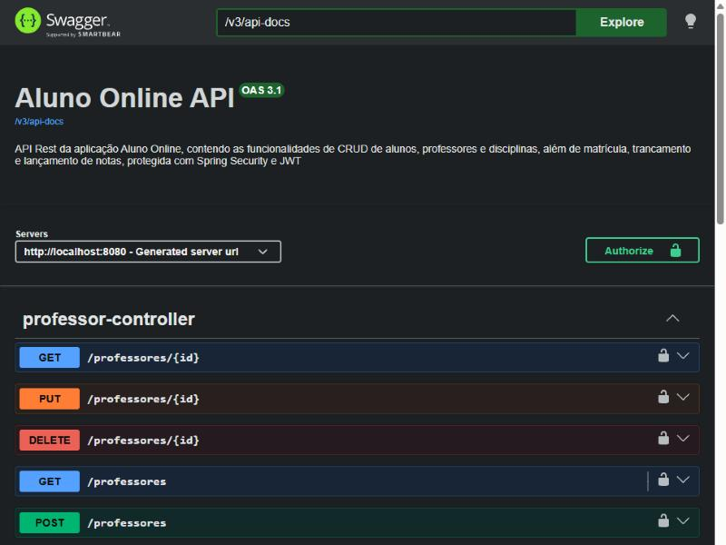
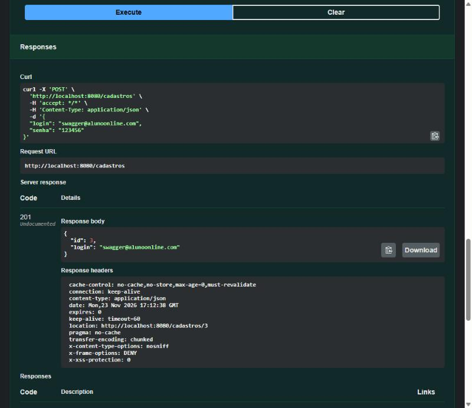
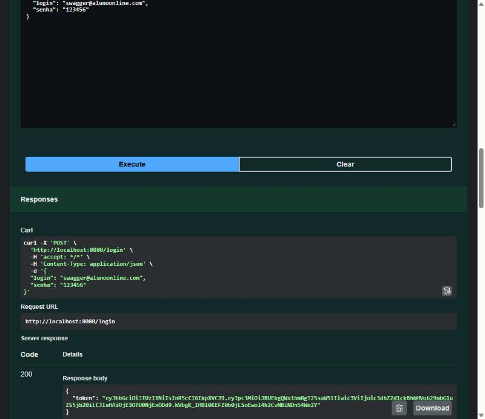
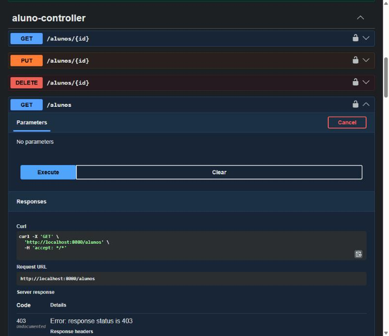
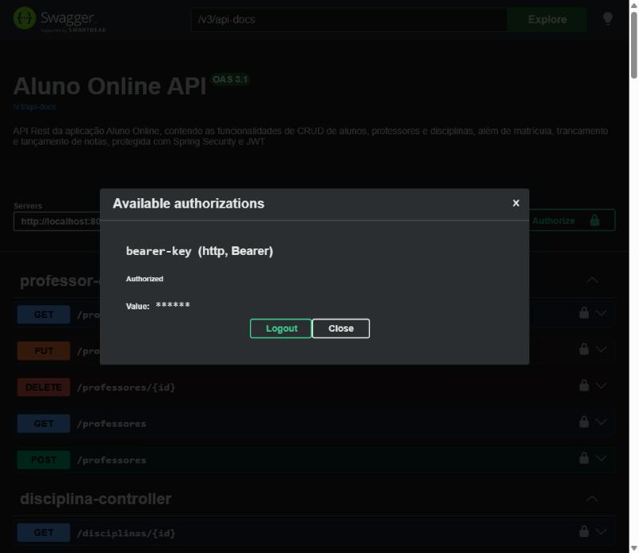
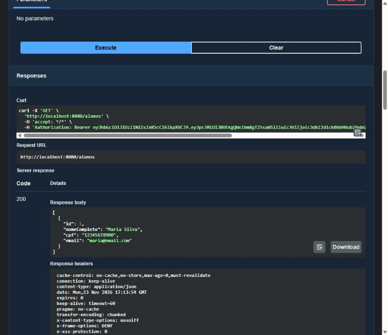
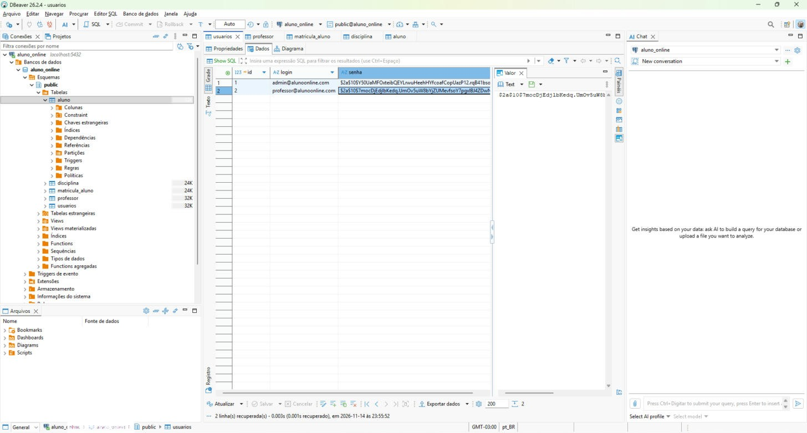
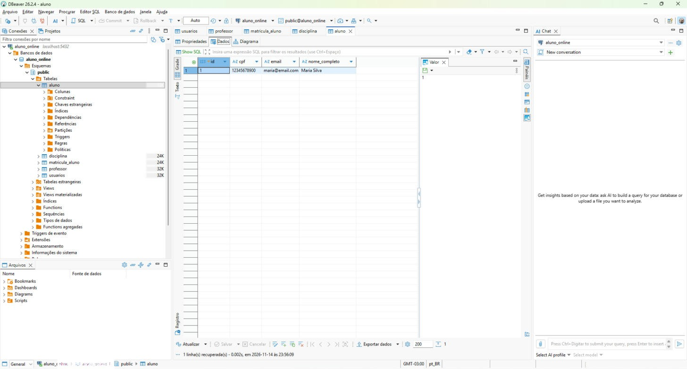

# 🔐 Aluno Online - API RESTful com Spring Security

Evolução da API **Aluno Online**, desenvolvida em Java com Spring Boot para o gerenciamento acadêmico (alunos, professores, disciplinas e matrículas). Nesta etapa, a API recebeu uma camada de **segurança com Spring Security e JSON Web Token (JWT)**: agora só usuários autenticados conseguem acessar os recursos da aplicação.

---

## 📖 Explicação do Projeto

Até a versão anterior, a API **Aluno Online** era pública: qualquer pessoa que soubesse o endereço conseguia cadastrar, listar, alterar e apagar dados. O objetivo desta etapa foi aplicar o **Spring Security**, seguindo as aulas da disciplina **Tecnologias para Back-End** (Prof. Junio Figueirêdo), para implementar:

- **Autenticação:** o usuário faz login com `login` e `senha` e recebe um **token JWT**.
- **Autorização:** todas as rotas da API exigem esse token no cabeçalho `Authorization: Bearer <token>`. Sem token, ou com um token inválido ou expirado, a requisição é bloqueada.
- **Senhas seguras:** as senhas ficam salvas no banco com **hash BCrypt**, nunca em texto puro.
- **Cadastro de usuários:** uma rota pública para criar novos usuários, com validação dos campos e tratamento de erros.
- **Documentação com Swagger:** a API é documentada automaticamente pelo SpringDoc. Na página do Swagger é possível cadastrar, fazer login, informar o token no botão **Authorize** e testar as rotas protegidas, que aparecem com um **cadeado**.

A API é **STATELESS**: o servidor não guarda sessão. Cada requisição traz o token, e o próprio token diz quem é o usuário.

Todo o domínio original (alunos, professores, disciplinas, matrículas, cálculo de média e trancamento) **foi mantido sem alterações de regra**. A segurança foi adicionada em classes novas. Nos controllers existentes, a única mudança foi a anotação `@SecurityRequirement`, que só afeta a documentação do Swagger.

---

## ⚙️ Descrição da Arquitetura Utilizada

A aplicação continua seguindo a **Arquitetura em Camadas** (Layered Architecture), agora com uma camada de **infraestrutura** para a segurança:

1. **Model (Entidades):** representação das tabelas no banco de dados. A nova entidade `Usuario` implementa a interface `UserDetails` do Spring Security, informando qual atributo é o usuário (`login`), qual é a senha (`senha`) e quais são os perfis (`ROLE_USER`).
2. **Repository (Persistência):** interfaces do Spring Data JPA. O novo `UsuarioRepository` tem o método `findByLogin`, usado no login e na validação do token.
3. **Service (Regra de Negócio):** o novo `AutenticacaoService` implementa `UserDetailsService`. O Spring Security o chama automaticamente no login para buscar o usuário no banco.
4. **Controller (Endpoints):** a porta de entrada da API. Novos controllers: `AutenticacaoController` (`POST /login`) e `UsuarioController` (`POST /cadastros`).
5. **Infra (Segurança e Erros):** pacote novo que concentra a configuração do Spring Security, o filtro de requisições, a geração e validação do token e o tratamento de erros de validação.

### 🔄 Fluxo de autenticação (login)

```text
POST /login  { "login": "...", "senha": "..." }
   │
   ▼
AutenticacaoController ──► AuthenticationManager ──► AutenticacaoService.loadUserByUsername()
   │                                                     │
   │                                                     ▼
   │                                       UsuarioRepository.findByLogin()  →  banco (tabela usuarios)
   │                                                     │
   │                              PasswordEncoder (BCrypt) confere a senha
   ▼
TokenService.gerarToken()  ──►  200 OK  { "token": "eyJ..." }
```

### 🛡️ Fluxo de autorização (demais requisições)

```text
GET /alunos   Authorization: Bearer eyJ...
   │
   ▼
SecurityFilter (roda antes do filtro padrão do Spring)
   ├─ recuperarToken()          → lê o cabeçalho Authorization e tira o "Bearer "
   ├─ TokenService.getSubject() → valida assinatura, emissor e expiração e devolve o login
   ├─ UsuarioRepository.findByLogin()
   └─ SecurityContextHolder     → marca o usuário como autenticado
   │
   ▼
SecurityConfigurations: /login e /cadastros liberados; todo o resto exige autenticação
   │
   ├─ autenticado      → Controller → 200 / 201 / 204
   └─ não autenticado  → 403 Forbidden
```

---

## 📂 Detalhamento do Código e Evolução

A organização dos pacotes reflete a arquitetura. Os arquivos marcados com ⭐ são os novos desta etapa:

```text
src/main/java/br/com/alunoonline/api/
 ├── controller/
 │    ├── AlunoController, ProfessorController, DisciplinaController, MatriculaAlunoController
 │    ├── ⭐ AutenticacaoController      # POST /login: autentica e devolve o token JWT
 │    └── ⭐ UsuarioController           # POST /cadastros: cadastra usuário com senha em BCrypt
 ├── dtos/
 │    ├── AtualizarNotasRequestDTO
 │    ├── ⭐ DadosAutenticacao           # login e senha recebidos no /login
 │    ├── ⭐ DadosCadastroUsuario        # login e senha com @NotBlank
 │    └── ⭐ DadosDetalhamentoUsuario    # resposta do cadastro (id e login, sem a senha)
 ├── infra/
 │    ├── ⭐ exception/TratadorDeErros   # @RestControllerAdvice: erros de validação viram 400
 │    ├── ⭐ springdoc/SpringDocConfigurations  # Swagger: esquema "bearer-key" (botão Authorize)
 │    └── ⭐ security/
 │         ├── SecurityConfigurations  # CSRF off, STATELESS, regras de acesso, BCrypt, AuthenticationManager
 │         ├── SecurityFilter          # filtro que valida o token em toda requisição
 │         ├── TokenService            # gera e valida o token JWT (HMAC256, expira em 2h)
 │         └── DadosTokenJWT           # resposta do login: { "token": "..." }
 ├── model/
 │    ├── Aluno, Professor, Disciplina, MatriculaAluno
 │    └── ⭐ Usuario                     # entidade da tabela usuarios, implementa UserDetails
 ├── repository/
 │    ├── AlunoRepository, ProfessorRepository, DisciplinaRepository, MatriculaAlunoRepository
 │    └── ⭐ UsuarioRepository           # findByLogin
 └── service/
      ├── AlunoService, ProfessorService, DisciplinaService, MatriculaAlunoService
      └── ⭐ AutenticacaoService         # implementa UserDetailsService
```

🛣️ Principais Rotas e Funcionalidades Implementadas:

**Rotas públicas (não precisam de token):**

POST /login: recebe `{ "login": "...", "senha": "..." }` e devolve `{ "token": "..." }`. Com a senha errada, devolve 403.

POST /cadastros: cadastra um novo usuário. A senha é salva com hash BCrypt. Campos vazios devolvem 400 com a lista de erros, e um login repetido devolve 400 "Login já Cadastrado!!!!".

**Rotas protegidas (precisam do cabeçalho `Authorization: Bearer <token>`):**

Cadastros Básicos (Alunos, Professores e Disciplinas):

POST: criação de novos registros (/alunos, /professores, /disciplinas).

GET: listagem geral e busca por ID de todos os cadastros.

PUT: atualização completa de cadastros existentes.

DELETE: remoção de registros do banco de dados.

Gestão de Matrículas e Notas (Regras de Negócio):

POST /matriculas: realiza a matrícula de um aluno em uma disciplina (iniciando com status "MATRICULADO").

PATCH /matriculas/atualizar-notas/{id}: lança a Nota 1 e a Nota 2. O sistema calcula a média automaticamente e define o status como "APROVADO" ou "REPROVADO".

PATCH /matriculas/trancar/{id}: altera o status da matrícula para "TRANCADO".

Sem token, com token alterado ou com token expirado, todas essas rotas devolvem **403 Forbidden**.

🛠️ Tecnologias Utilizadas
Java 21

Spring Boot 4 (Web, Data JPA, Validation)

Spring Security 7 (autenticação, autorização e BCrypt)

Auth0 java-jwt 4.5.1 (geração e validação dos tokens JWT)

PostgreSQL (Banco de dados relacional)

Lombok (Redução de boilerplate de código)

Maven (Gerenciamento de dependências)

SpringDoc OpenAPI 3.0.3 / Swagger UI (Documentação e teste das rotas pelo navegador)

DBeaver (Visualização do banco de dados)

## ▶️ Como Executar

1. Crie o banco `aluno_online` no PostgreSQL (as tabelas são criadas automaticamente pelo Hibernate).
2. Configure as variáveis de ambiente (por exemplo, nas *Environment variables* da configuração de execução do IntelliJ):

   | Variável | Obrigatória | Padrão |
   |---|---|---|
   | `DB_PASSWORD` | sim | — |
   | `DB_USERNAME` | não | `postgres` |
   | `DB_URL` | não | `jdbc:postgresql://localhost:5432/aluno_online` |
   | `JWT_SECRET` | não | `12345678` (só para desenvolvimento) |

3. Rode a aplicação (`AlunoOnlineApplication`). Ela sobe em `http://localhost:8080`, e a documentação fica em **`http://localhost:8080/swagger-ui/index.html`** (aberta, sem login).
4. Crie um usuário em `POST /cadastros`, faça login em `POST /login` e use o token devolvido como **Bearer Token** nas demais rotas (veja o passo a passo abaixo).

## 🔑 Primeiro Acesso

⚠️ **Ao rodar o projeto em um banco novo, não existe nenhum usuário cadastrado.** O cadastro de usuários é **público** (não precisa de token nem de outra conta), então qualquer pessoa consegue criar o próprio acesso:

**1. Cadastre um usuário (sem token):**

```http
POST http://localhost:8080/cadastros
Content-Type: application/json

{
  "login": "professor@alunoonline.com",
  "senha": "123456"
}
```

Resposta esperada: **201 Created** com `{ "id": 1, "login": "professor@alunoonline.com" }`. A senha é salva no banco com hash BCrypt.

**2. Faça login com o mesmo usuário (sem token):**

```http
POST http://localhost:8080/login
Content-Type: application/json

{
  "login": "professor@alunoonline.com",
  "senha": "123456"
}
```

Resposta esperada: **200 OK** com `{ "token": "eyJ..." }`.

**3. Use o token nas demais rotas:**

No **Swagger**, clique em **Authorize**, cole o valor do `token` (sem as aspas) no campo `bearer-key` e clique em **Authorize**. A partir daí, todas as rotas passam a enviar o token.

Isso equivale a enviar o cabeçalho:

```http
GET http://localhost:8080/alunos
Authorization: Bearer eyJ...
```

O token vale por **2 horas**. Depois disso, faça login novamente para gerar outro.

## 📸 Testes e Demonstração

### 1. Requisições no Swagger

**Página do Swagger, com o botão Authorize e o cadeado nas rotas protegidas:**


**Cadastrando um Usuário pelo Swagger, sem token (POST /cadastros):**


**Efetuando Login pelo Swagger (POST /login), devolvendo o Token JWT:**


**Listando Alunos sem Autorizar (GET /alunos), bloqueado com 403:**


**Informando o Token no Authorize (esquema bearer-key):**


**Listando Alunos depois do Authorize (GET /alunos), com o cabeçalho Authorization: Bearer:**


### 2. Persistência no DBeaver (PostgreSQL)

**Tabela de Usuários, com as senhas salvas em hash BCrypt:**


**Tabela de Alunos Atualizada Depois dos Testes:**


## 👨‍💻 Autor
Rodolfo Santiago Romero  Garcia
Ciência da Computação - UNIESP
